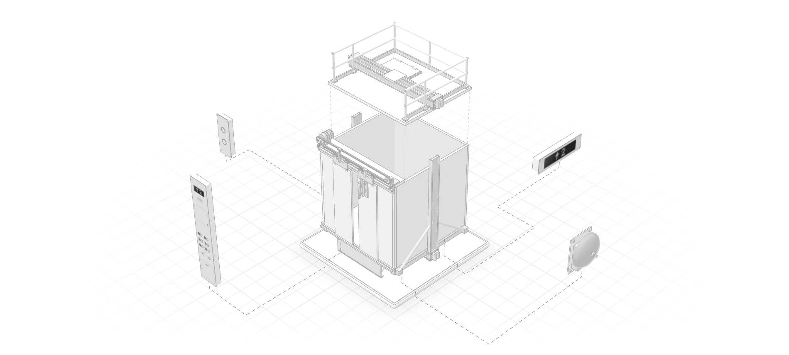

Welcome to the Hera documentation. Hera is a modular elevator controller for Roblox developed by Restrafes & Co. You can configure its motion, control front and rear doors separately, connect your own fixtures, and add server-side extensions.

<CardGroup cols={2}>
  <Card title="Get started" icon="rocket" href="/hera/getting-started">
    Set up a supplied model and run it in Studio.
  </Card>
  <Card title="Configuration" icon="settings-2" href="/hera/configuration/overview">
    Configure motion, doors, fixtures, sounds, and service modes.
  </Card>
  <Card title="Extensions" icon="puzzle" href="/hera/extensions/getting-started">
    Add custom behavior with server-side modules.
  </Card>
  <Card title="Controller API" icon="braces" href="/hera/integration/controller-api">
    Send calls and connect server-side accessories.
  </Card>
  <Card title="States and events" icon="radio" href="/hera/reference/events">
    Look up car state and event data.
  </Card>
  <Card title="Troubleshooting" icon="wrench" href="/hera/reference/troubleshooting">
    Find causes of startup, call, door, and integration issues.
  </Card>
</CardGroup>
